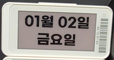
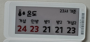
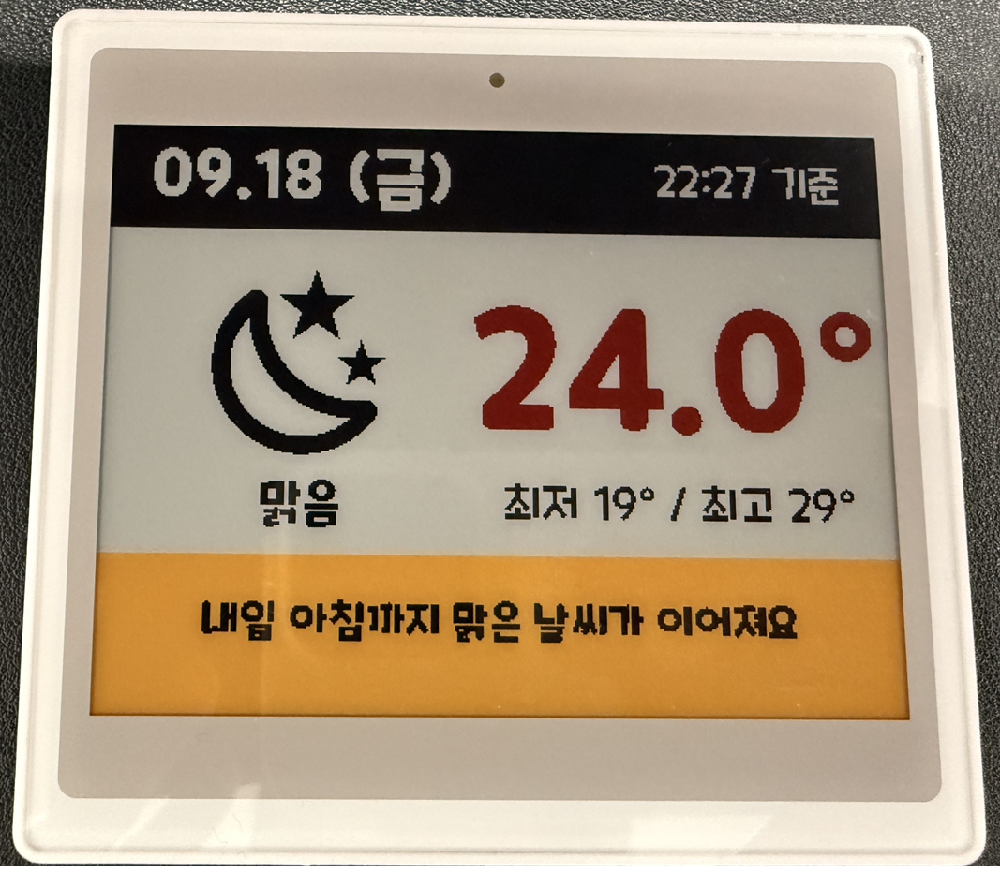
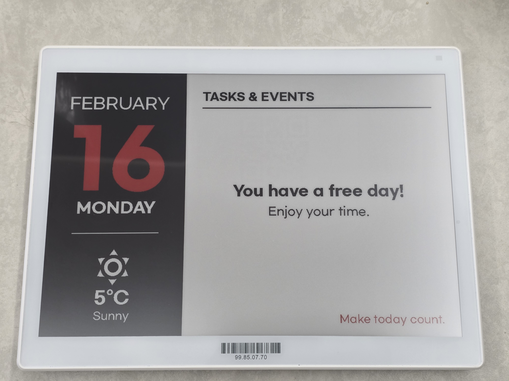

<!-- hass-standards:header:start -->
# BLE ESL for Home Assistant

Bluetooth 저전력 전자가격표시기(ESL)에 레이아웃을 전송하는 Home Assistant 커스텀 통합입니다.

[English](README.md) | **한국어**

<!-- hass-standards:badges:start -->
[](https://github.com/eigger/hass-ble-esl/releases)
[](#설치)
[](hacs.json)
[](https://github.com/eigger/hass-ble-esl/actions/workflows/tests.yml)
[](https://github.com/eigger/hass-ble-esl/actions/workflows/validate.yml)
[](LICENSE)
[](https://github.com/eigger/hass-ble-esl/releases)
<!-- hass-standards:badges:end -->
<!-- hass-standards:header:end -->


Home Assistant 액션 한 번으로 전자종이 태그에 일정, 날씨, 센서 값, 사진을 표시할 수 있습니다. 전용 ESL 게이트웨이나 클라우드 서비스 없이 Bluetooth로 화면을 갱신하며, 태그는 배터리로 수개월에서 수년까지 동작할 수 있습니다.

| 2.1" (250×128) | 2.9" (296×128) | 4.2" (400×300) | 10.2" (960×640) |
| --- | --- | --- | --- |
|  |  |  |  |
| Gicisky | Gicisky | Poshiji PSJ-420 | Gicisky |

[YAML 예제 더 보기 (영어)](examples/README.md)

## 지원 태그

| 브랜드 | 프로토콜 | 크기 | 색상 | 실기기 검증 |
| --- | --- | --- | --- | --- |
| Hipoink | ETAG | 2.13" | BWR | 2.13" |
| Gicisky | PickSmart | 2.1"–10.2" | BW / BWR / BWRY | 목록의 모든 모델 |
| Poshiji | XTE | 1.54"–7.5" | BWRY | 2.13", 2.66", 2.9", 4.2", 7.5" |
| Zhsunyco | WOLINK | 1.54"–13.3" | BWR / BWRY | 1.54", 2.66", 2.9", 3.5", 3.7", 4.2" (BWRY) 및 2.9" (BWR) |
| Zhsunyco | easyTag | 1.54"–10.2" | BW / BWR | 미검증 |

[모델 코드, 해상도, 구매처 (영어)](docs/models.md)

## 주요 기능

- 사이드바의 **ESL Manager**에서 태그와 전송 상태를 확인합니다. 편집기에서 레이아웃을 디자인하고 미리 본 뒤 자동화용 YAML로 내보낼 수 있습니다.
- **쓰기 액션**은 [imagespec](https://github.com/eigger/imagespec) 요소와 Jinja 템플릿을 렌더링합니다. `ble_esl.write_guarded`는 쓰기 잠금(Write Lock)을 적용하고, 동일한 이미지를 건너뛰며, 연속 호출을 디바운스합니다.
- **진단 정보**에서 쓰기가 실패한 단계와 사용한 Bluetooth 어댑터 또는 프록시를 확인합니다.

## 요구사항

- **Home Assistant:** 2025.12.0 이상.
- **Bluetooth:** 활성 연결을 지원하는 Bluetooth 어댑터 또는 ESPHome Bluetooth 프록시. [Bluetooth](#bluetooth)를 참고하세요.
- **기기:** [지원 태그](#지원-태그)에 나열된 태그.

## 설치

<!-- hass-standards:installation:start -->
[](https://my.home-assistant.io/redirect/hacs_repository/?owner=eigger&repository=hass-ble-esl)
<!-- hass-standards:installation:end -->

1. 위 배지를 클릭해 마켓플레이스에서 저장소를 엽니다.
2. 저장소를 직접 추가하려면 **설정 → 마켓플레이스 → 링크에서 추가**에서 <https://github.com/eigger/hass-ble-esl>을 입력합니다. 안내가 표시되면 GitHub 계정을 연결합니다.
3. **설치**를 선택합니다. 재시작 안내가 표시되면 Home Assistant를 재시작합니다. 설치가 끝나면 [설정](#설정)으로 이동합니다.

Home Assistant 2026.11 이전 버전에서는 같은 배지가 HACS를 엽니다. [HACS 설정 (영어)](https://www.hacs.xyz/docs/use/)

## 설정

자동으로 발견된 태그는 **설정 → 기기 및 서비스**에서 확인합니다. 수동으로 등록하려면 **통합구성요소 추가 → BLE ESL**을 선택하세요.

**구성**에서 재시도 횟수, 중복 전송 방지, 디바운스 지연을 설정할 수 있습니다. WOLINK 또는 easyTag는 기기에 맞는 **모델**을 선택하세요. [통합 옵션](docs/ko/usage.md#옵션)

`hass-gicisky`나 `hass-zhsunyco`에서 옮겨오는 경우 BLE ESL에 태그를 다시 추가하고 `gicisky.write`를 `ble_esl.write`로 바꾸세요. 기존 페이로드를 재사용할 수 있습니다. [마이그레이션 가이드](docs/ko/migration.md)

### Bluetooth

ESPHome 프록시를 사용한다면 `bluetooth_proxy.active: true`를 켜세요. [스캔 옵션과 ESPHome 설정 예제](docs/ko/bluetooth.md)

BLE ESL은 첫 쓰기 때 페어링 없이 연결합니다. ETAG 제조사 앱을 닫고 여러 통합에서 같은 태그에 쓰지 않도록 하세요. [Bluetooth 프록시 가이드](https://github.com/eigger/blesession/blob/main/docs/bluetooth.ko.md)

## 빠른 시작

**개발자 도구 → 액션**에서 `ble_esl.write`를 선택하고 태그를 대상으로 지정하세요.

```yaml
action: ble_esl.write
target:
  device_id: <your device>
data:
  payload:
    - type: text
      value: Hello World!
      x: 10
      "y": 10
      size: 40
```

몇 초 뒤 태그가 갱신됩니다. 전송 전에 미리 보려면 `data` 아래에 `dry_run: true`를 추가하고 **Preview Content** 이미지 엔티티를 확인하세요. [페이로드 안내와 액션 예제](docs/payload.ko.md)

<a name="제한사항과-주의"></a>

## 중요 제한사항

> [!WARNING]
> 표의 실기기 검증 목록에 없는 WOLINK 프리셋과 모든 easyTag 프리셋은 기술 사양을 바탕으로 만들었습니다. 사용해 보셨다면 [Discussions](https://github.com/eigger/hass-ble-esl/discussions)에 모델과 결과를 공유해 주세요.

- 그 외 XTE 크기는 화면 크기만 반영한 프리셋을 직접 선택합니다. 기기와 맞지 않는 프리셋을 선택하면 전송에 성공해도 화면이 깨질 수 있습니다.
- 센서 값이 바뀔 때 태그를 갱신하려면 Home Assistant 자동화를 사용하세요. 배터리를 오래 쓰려면 갱신 간격을 충분히 두세요.

## 문서

| 주제 | 한국어 | English |
| --- | --- | --- |
| 사용법과 옵션 | [한국어](docs/ko/usage.md) | [English](docs/usage.md) |
| ESL Manager와 디자이너 | [한국어](docs/ko/designer.md) | [English](docs/designer.md) |
| 디자인 템플릿 | [한국어](docs/ko/design-templates.md) | [English](docs/design-templates.md) |
| 페이로드 안내 | [한국어](docs/payload.ko.md) | [English](docs/payload.md) |
| 액션, 엔티티, 글꼴 | — | [English](docs/actions.md) |
| Bluetooth 설정 | [한국어](docs/ko/bluetooth.md) | [English](docs/bluetooth.md) |
| 문제 해결 | [한국어](docs/troubleshooting.ko.md) | [English](docs/troubleshooting.md) |
| 마이그레이션 | [한국어](docs/ko/migration.md) | [English](docs/migration.md) |
| 프로토콜 노트 | — | [ETAG](docs/etag.md), [XTE](docs/xte.md) |
| 개발 | — | [테스트와 개발](docs/development.md), [프로토콜 추가](custom_components/ble_esl/esl_ble/README.md) |

## 문제 해결과 진단

- 쓰기 실패를 제보할 때는 **기기 페이지 → ⋮ → 진단 다운로드**에서 태그의 진단 파일을 첨부해 주세요. [공유 전 가려야 할 정보](docs/troubleshooting.ko.md#올리기-전에-민감-정보-제거)
- Poshiji 프리셋을 직접 선택했다면 패널 크기, 선택한 프리셋, 전송 결과를 함께 알려 주세요.

<!-- hass-standards:support:start -->
## 지원

- [Issues](https://github.com/eigger/hass-ble-esl/issues): 버그를 신고하거나 기능을 요청하세요.
- [Discussions](https://github.com/eigger/hass-ble-esl/discussions): 질문하고 사용 경험을 공유하세요.
<!-- hass-standards:support:end -->

<!-- hass-standards:related-projects:start -->
## 관련 프로젝트

- [imagespec](https://github.com/eigger/imagespec): `payload:` 뒤의 렌더러입니다.
- [Stash](https://github.com/eigger/stash): ESL 태그에 라벨을 출력하는 가정 재고 관리자입니다.
- [hass-gicisky](https://github.com/eigger/hass-gicisky): 보관 처리된 BLE ESL의 전신입니다.
<!-- hass-standards:related-projects:end -->

<!-- hass-standards:license:start -->
## 라이선스

[MIT License](LICENSE) 라이선스로 배포됩니다.
<!-- hass-standards:license:end -->
