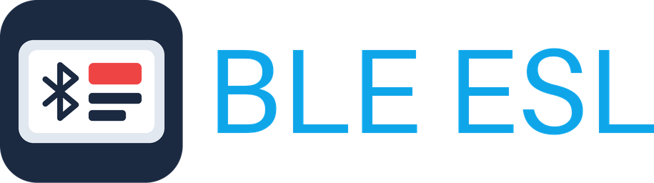
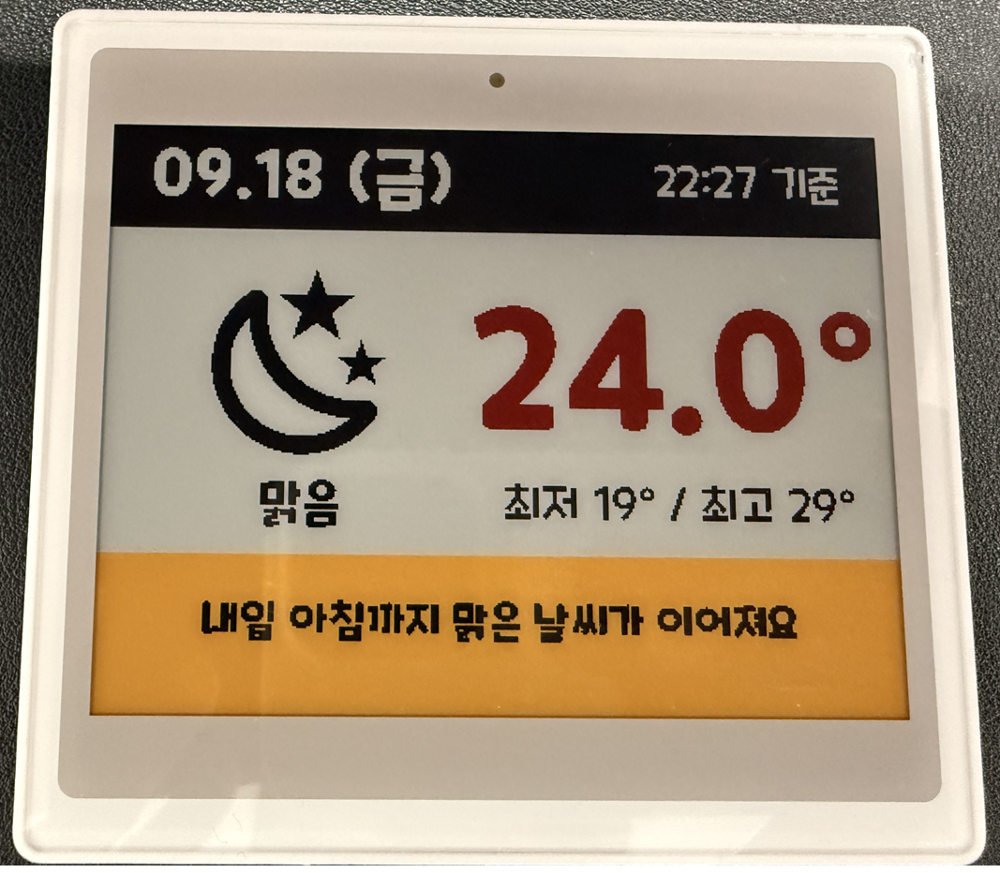
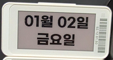
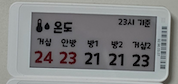
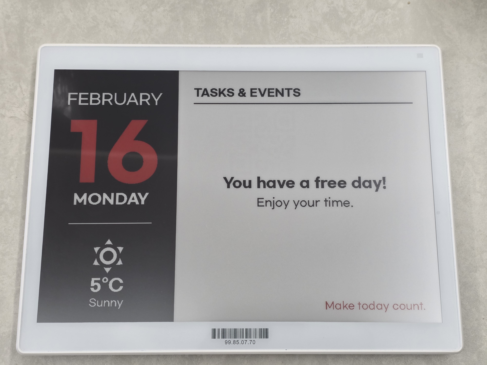

<!-- hass-standards:header:start -->
# BLE ESL for Home Assistant

Bluetooth 저전력 전자가격표시기(ESL)에 레이아웃을 전송하는 Home Assistant 커스텀 통합입니다.

[English](README.md) | **한국어**

<!-- hass-standards:badges:start -->
[](https://github.com/eigger/hass-ble-esl/releases)
[](#설치)
[](hacs.json)
[](https://github.com/eigger/hass-ble-esl/actions/workflows/tests.yml)
[](https://github.com/eigger/hass-ble-esl/actions/workflows/validate.yml)
[](LICENSE)
[](https://github.com/eigger/hass-ble-esl/releases)
<!-- hass-standards:badges:end -->
<!-- hass-standards:header:end -->



> 영어 문서가 기준입니다. 내용이 다르면 [영어 README](README.md)를 따릅니다.

Home Assistant 액션 한 번으로 e-paper 태그에 캘린더, 날씨, 센서 값 또는 사진을 Bluetooth로 전송합니다. 태그는 게이트웨이, 클라우드, 배선 없이 배터리 하나로 수개월에서 수년 동안 동작할 수 있습니다.

Home Assistant Core에 포함된 통합이 아니며 Core 품질 등급을 주장하지 않습니다. [왜 e-paper 태그인가? →](docs/ko/usage.md#왜-e-paper-태그인가)

<p align="center">
<ruby><bdi>Poshiji PSJ-420 · 4.2″ (400×300)</bdi><rt></rt></ruby> &emsp;
<ruby><bdi>Gicisky · 2.1″ (250×128)</bdi><rt></rt></ruby> &emsp;
<ruby><bdi>Gicisky · 2.9″ (296×128)</bdi><rt></rt></ruby> &emsp;
<ruby><bdi>Gicisky · 10.2″ (960×640)</bdi><rt></rt></ruby>
</p>

[YAML이 포함된 예제 더 보기 →](examples/README.md) (영어)

## 지원 태그

| 프로토콜 | 브랜드 | 크기 | 색상 | 상태 | 구매 |
|---|---|---|---|---|---|
| **ETAG** | Hipoink | 2.13" (250 × 122) | BWR | ✅ 검증; [프로토콜 노트](docs/etag.md) (영어) | [AliExpress](https://de.aliexpress.com/item/1005009110927073.html) |
| **PickSmart** | Gicisky | 2.1" – 10.2" | BW / BWR / BWRY | ✅ 실기기 검증 | [AliExpress](https://ko.aliexpress.com/item/1005002399342939.html) |
| **XTE** | Poshiji | 1.54" – 7.5" | BWRY | ✅ 2.13", 2.66", 2.9", 4.2"는 실기기 검증 완료; 다른 크기는 크기만 맞춘 프리셋 | [AliExpress](https://ko.aliexpress.com/item/1005012725381116.html) |
| **WOLINK** | Zhsunyco | 1.54" – 13.3" | BWR / BWRY | ✅ 1.54", 2.66", 3.5", 3.7", 4.2" BWRY와 2.9" BWR 실기기 검증 완료; 다른 크기는 미검증 | [AliExpress](https://ko.aliexpress.com/item/1005009231276243.html) |
| **easyTag** | Zhsunyco | 1.54" – 10.2" | BW / BWR | ⚠️ 사양서 기반, 미검증 | — |

해상도와 모델 코드는 [전체 모델 목록](docs/models.md)에서 확인하세요. 다른 태그는 [프로토콜 추가하기](custom_components/ble_esl/esl_ble/README.md)를 참고하세요. 두 문서는 영어입니다.

## 주요 기능

- [imagespec](https://github.com/eigger/imagespec) 요소와 Jinja 템플릿으로 레이아웃을 만들고 `ble_esl.write`로 전송합니다. `ble_esl.write_guarded`는 이미지가 같으면 건너뛰고, Write Lock을 따르며, 연속 호출을 디바운스합니다.
- **ESL Manager**: 같은 payload를 YAML로 내보내는 사이드바 대시보드와 비주얼 디자이너.
- 쓰기가 어느 단계에서, 어떤 라디오를 거쳐 실패했는지 알려 주는 실패 센서와 진단 다운로드.

## 요구사항

- **Home Assistant:** 2025.12.0 이상.
- **Bluetooth:** 활성 연결을 지원하는 Bluetooth 어댑터 또는 ESPHome Bluetooth 프록시. [Bluetooth](#bluetooth)를 참고하세요.
- **기기:** [지원 태그](#지원-태그)에 나열된 태그.

## 설치

<!-- hass-standards:installation:start -->
[](https://my.home-assistant.io/redirect/hacs_repository/?owner=eigger&repository=hass-ble-esl)
<!-- hass-standards:installation:end -->

1. 위 배지를 클릭해 마켓플레이스에서 저장소를 엽니다.
2. 저장소를 직접 추가하려면 **설정 → 마켓플레이스 → 링크에서 추가**에서 <https://github.com/eigger/hass-ble-esl>을 입력합니다. 안내가 표시되면 GitHub 계정을 연결합니다.
3. **설치**를 선택합니다. 재시작 안내가 표시되면 Home Assistant를 재시작합니다. 설치가 끝나면 [설정](#설정)으로 이동합니다.

## 설정

범위 안의 태그는 자동으로 발견됩니다 — **설정 → 기기 및 서비스**에서 확인하거나, **통합구성요소 추가 → BLE ESL**로 추가합니다.

옵션(Retry Count, Prevent Duplicate Send, Debounce Delay, WOLINK / easyTag의 Model)은 **구성**에 있습니다. [docs/ko/usage.md](docs/ko/usage.md#옵션)를 보세요.

`hass-gicisky`나 `hass-zhsunyco`에서 오셨나요? 태그를 새 `ble_esl` 도메인으로 다시 추가하고 `gicisky.write`를 `ble_esl.write`로 바꿔야 합니다 — 페이로드는 그대로입니다. **[마이그레이션 가이드 →](docs/ko/migration.md)**

### Bluetooth

원격 Bluetooth 연결은 `bluetooth_proxy: active: true`로 켭니다. 스캔은 `esp32_ble_tracker: scan_parameters: active: true`와 기본 간격으로 시작하세요. 활성 연결을 켜 두면 패시브 스캔에서도 GATT 연결을 사용할 수 있습니다.

첫 쓰기 때 GATT로 연결합니다. 페어링은 필요 없습니다. ETAG 제조사 앱을 닫고 다른 통합이 같은 태그에 쓰지 않도록 하세요.

하드웨어, 설정, 연결 문제 해결은 [Bluetooth 프록시 가이드](https://github.com/eigger/blesession/blob/main/docs/bluetooth.ko.md)를 참고하세요.

## 빠른 시작

**개발자 도구 → 액션**에서:

```yaml
action: ble_esl.write
target:
  device_id: <your device>
data:
  payload:
    - type: text
      value: Hello World!
      x: 10
      "y": 10
      size: 40
```

몇 초 뒤 태그가 갱신됩니다.

`dry_run: true`를 붙이면 태그에 전송하지 않고 렌더링합니다. **Preview Content** 이미지 엔티티에는 렌더링 결과가 표시되며 패널의 실제 화면은 읽어 오지 않습니다.

렌더링 옵션과 전체 액션 예제는 [payload 안내](docs/payload.ko.md), 레이아웃과 사용법, 비주얼 디자이너는 [문서 목록](#문서)을 보세요.

<a name="제한사항과-주의"></a>

## 중요 제한사항

> [!WARNING]
> 미검증 WOLINK 및 easyTag 프리셋은 기술 사양서로 만들어졌으며 실제 태그에서 테스트되지 않았습니다. 써 보셨다면 [Discussions](https://github.com/eigger/hass-ble-esl/discussions)에 결과를 알려 주세요.

- XTE의 2.13", 2.66", 2.9", 4.2" 외 크기는 손으로 고르는 크기만 맞춘 프리셋입니다. 하드웨어와 맞지 않는 프리셋은 쓰기는 성공해도 화면이 이상하게 나올 수 있습니다.
- 디자이너는 센서 변경 시 자동 전송하지 않습니다. 자동화로 갱신 시점을 정하세요. e-paper는 LCD가 아니므로 너무 잦은 갱신은 피하세요. `write_guarded`와 Prevent Duplicate Send / Debounce Delay 옵션이 도움이 됩니다.

## 문서

| 주제 | 한국어 | English |
|---|---|---|
| 사용 개요: 첫 레이아웃, 비주얼 에디터, 액션, 옵션, 페이로드와 렌더링 | [docs/ko/usage.md](docs/ko/usage.md) | [docs/usage.md](docs/usage.md) |
| Bluetooth 설정 및 ESPHome 예제 | [docs/ko/bluetooth.md](docs/ko/bluetooth.md) | [docs/bluetooth.md](docs/bluetooth.md) |
| 태그 문제 해결과 실패 센서 | [docs/troubleshooting.ko.md](docs/troubleshooting.ko.md) | [docs/troubleshooting.md](docs/troubleshooting.md) |
| 액션, 응답 데이터, 엔티티, 폰트 | — (영어만) | [docs/actions.md](docs/actions.md) |
| 지원 모델과 구매처 | — (영어만) | [docs/models.md](docs/models.md) |
| ESL Manager / 디자이너 | [docs/ko/designer.md](docs/ko/designer.md) | [docs/designer.md](docs/designer.md) |
| 디자인 템플릿 | [docs/ko/design-templates.md](docs/ko/design-templates.md) | [docs/design-templates.md](docs/design-templates.md) |
| hass-gicisky / hass-zhsunyco에서 마이그레이션 | [docs/ko/migration.md](docs/ko/migration.md) | [docs/migration.md](docs/migration.md) |
| 프로토콜 노트 (ETAG, XTE) | — (영어만) | [docs/etag.md](docs/etag.md), [docs/xte.md](docs/xte.md) |
| 예제 | — (영어만) | [examples/README.md](examples/README.md) |
| 개발: 테스트, 검증 환경, 린트, 프로토콜 추가 | — (영어만) | [docs/development.md](docs/development.md) |

## 문제 해결과 진단

- 버그를 제보할 때는 태그의 진단 파일을 첨부해 주세요: **기기 페이지 → ⋮ → 진단 다운로드**. 프로토콜, 프리셋, 펌웨어, 옵션, 마지막 광고, 실패 카운터가 들어 있습니다.
- 태그 MAC은 가려지지만 나머지 데이터는 올리기 전에 확인하세요 — [제거할 정보](docs/troubleshooting.ko.md#올리기-전에-민감-정보-제거).
- Poshiji 태그에서 모델을 직접 선택해야 했다면 아래 지원 링크로 태그 크기와 결과를 알려 주세요.

<!-- hass-standards:support:start -->
## 지원

- [Issues](https://github.com/eigger/hass-ble-esl/issues): 버그를 신고하거나 기능을 요청하세요.
- [Discussions](https://github.com/eigger/hass-ble-esl/discussions): 질문하고 사용 경험을 공유하세요.
<!-- hass-standards:support:end -->

<!-- hass-standards:related-projects:start -->
## 관련 프로젝트

- [imagespec](https://github.com/eigger/imagespec): `payload:` 뒤의 렌더러입니다.
- [Stash](https://github.com/eigger/stash): ESL 태그에 라벨을 출력하는 가정 재고 관리자입니다.
- [hass-gicisky](https://github.com/eigger/hass-gicisky): 보관 처리된 BLE ESL의 전신입니다.
<!-- hass-standards:related-projects:end -->

<!-- hass-standards:license:start -->
## 라이선스

[MIT License](LICENSE) 라이선스로 배포됩니다.
<!-- hass-standards:license:end -->
