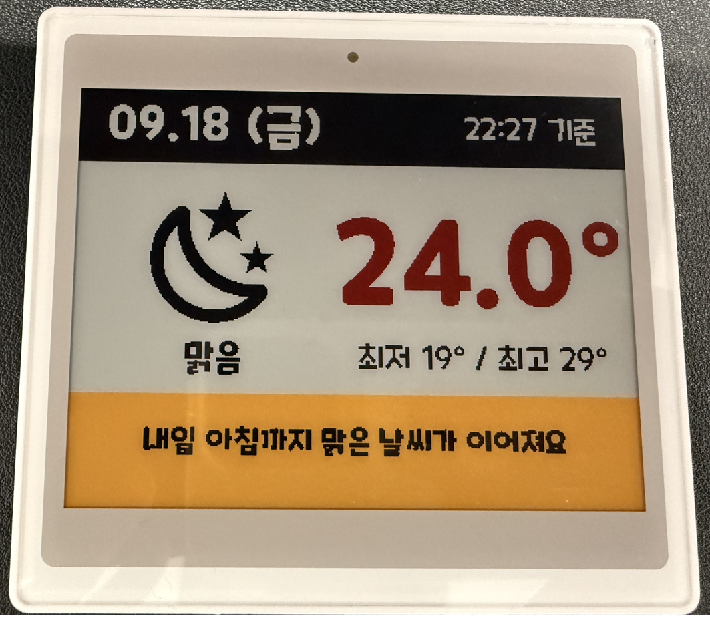

<!-- hass-standards:header:start -->
# BLE ESL for Home Assistant

A Home Assistant custom integration that sends layouts to Bluetooth Low Energy electronic shelf labels.

**English** | [한국어](README.ko.md)

<!-- hass-standards:badges:start -->
[](https://github.com/eigger/hass-ble-esl/releases)
[](#installation)
[](hacs.json)
[](https://github.com/eigger/hass-ble-esl/actions/workflows/tests.yml)
[](https://github.com/eigger/hass-ble-esl/actions/workflows/validate.yml)
[](LICENSE)
[](https://github.com/eigger/hass-ble-esl/releases)
<!-- hass-standards:badges:end -->
<!-- hass-standards:header:end -->


Display calendars, weather, sensor readings, or photos on e-paper tags with a single Home Assistant action. Tags update over Bluetooth without a dedicated ESL gateway or cloud service and can run for months or even years on batteries.

| 2.1" (250×128) | 2.9" (296×128) | 4.2" (400×300) | 10.2" (960×640) |
| --- | --- | --- | --- |
|  |  |  |  |
| Gicisky | Gicisky | Poshiji PSJ-420 | Gicisky |

[More examples with YAML](examples/README.md)

## Supported tags

| Brand | Protocol | Sizes | Colors | Tested on hardware |
| --- | --- | --- | --- | --- |
| Hipoink | ETAG | 2.13" | BWR | 2.13" |
| Gicisky | PickSmart | 2.1"–10.2" | BW / BWR / BWRY | All listed models |
| Poshiji | XTE | 1.54"–7.5" | BWRY | 2.13", 2.66", 2.9", 4.2", 7.5" |
| Zhsunyco | WOLINK | 1.54"–13.3" | BWR / BWRY | 1.54", 2.66", 2.9", 3.5", 3.7", 4.2" (BWRY) and 2.9" (BWR) |
| Zhsunyco | easyTag | 1.54"–10.2" | BW / BWR | Untested |

[Model codes, resolutions, and purchase links](docs/models.md)

## Features

- **ESL Manager** shows tag and transmission status in the sidebar. Design layouts visually, preview them, and export YAML for automations.
- **Write actions** render [imagespec](https://github.com/eigger/imagespec) elements and Jinja templates. `ble_esl.write_guarded` respects Write Lock, skips unchanged images, and debounces rapid calls.
- **Diagnostics** show where a write failed and which Bluetooth adapter or proxy was used.

## Requirements

- **Home Assistant:** 2025.12.0 or later.
- **Bluetooth:** A Bluetooth adapter or an ESPHome Bluetooth proxy that supports active connections. See [Bluetooth](#bluetooth).
- **Device:** A supported tag from [Supported tags](#supported-tags).

## Installation

<!-- hass-standards:installation:start -->
[](https://my.home-assistant.io/redirect/hacs_repository/?owner=eigger&repository=hass-ble-esl)
<!-- hass-standards:installation:end -->

1. Click the badge above to open the repository in Marketplace.
2. If you need to add it yourself, go to **Settings → Marketplace → Add from link** and enter <https://github.com/eigger/hass-ble-esl>. Connect GitHub if prompted.
3. Select **Install**. Restart Home Assistant if prompted, then continue to [Configuration](#configuration).

On Home Assistant versions before 2026.11, the same badge opens HACS. [HACS setup](https://www.hacs.xyz/docs/use/)

## Configuration

Confirm discovered tags in **Settings → Devices & services**. To add a tag manually, choose **Add integration → BLE ESL**.

Set retries, duplicate prevention, and debounce under **Configure** (duplicate prevention and debounce apply to `ble_esl.write_guarded` only). Choose the matching **Model** for WOLINK or easyTag. [Integration options](docs/usage.md#options)

If you use `hass-gicisky` or `hass-zhsunyco`, re-add the tags in BLE ESL and replace `gicisky.write` with `ble_esl.write`. You can reuse the same payload. [Migration guide](docs/migration.md)

### Bluetooth

For ESPHome proxies, enable `bluetooth_proxy.active: true`. [Scan settings and ESPHome example](docs/bluetooth.md)

BLE ESL connects on the first write without pairing. Close the ETAG companion app and avoid writing to the same tag from multiple integrations. [Bluetooth proxy guide](https://github.com/eigger/blesession/blob/main/docs/bluetooth.md)

## Quick start

In **Developer tools → Actions**, select your tag as the target for `ble_esl.write`.

```yaml
action: ble_esl.write
target:
  device_id: <your device>
data:
  payload:
    - type: text
      value: Hello World!
      x: 10
      "y": 10
      size: 40
```

The tag refreshes in a few seconds. To preview the layout without sending it, add `dry_run: true` under `data` and open the **Preview Content** image entity. [Payload guide and action examples](docs/payload.md)

<a name="limits-and-warnings"></a>

## Important limitations

> [!WARNING]
> WOLINK presets outside the tested list and all easyTag presets are based on specifications. If you try one, share the model and result in [Discussions](https://github.com/eigger/hass-ble-esl/discussions).

- Other XTE sizes use manually selected, size-only presets. A mismatched preset can write successfully and still display the image incorrectly.
- Use Home Assistant automations to update tags when sensors change. Keep refreshes infrequent to preserve battery life.

## Documentation

| Topic | English | 한국어 |
| --- | --- | --- |
| Usage and options | [English](docs/usage.md) | [한국어](docs/ko/usage.md) |
| ESL Manager and Designer | [English](docs/designer.md) | [한국어](docs/ko/designer.md) |
| Design templates | [English](docs/design-templates.md) | [한국어](docs/ko/design-templates.md) |
| Payload guide | [English](docs/payload.md) | [한국어](docs/payload.ko.md) |
| Actions, entities, and fonts | [English](docs/actions.md) | — |
| Bluetooth setup | [English](docs/bluetooth.md) | [한국어](docs/ko/bluetooth.md) |
| Troubleshooting | [English](docs/troubleshooting.md) | [한국어](docs/troubleshooting.ko.md) |
| Migration | [English](docs/migration.md) | [한국어](docs/ko/migration.md) |
| Protocol notes | [ETAG](docs/etag.md), [XTE](docs/xte.md) | — |
| Development | [Tests and development](docs/development.md), [Adding a protocol](custom_components/ble_esl/esl_ble/README.md) | — |

## Troubleshooting and diagnostics

- For write failures, attach the tag's diagnostics from **Device page → ⋮ → Download diagnostics**. [What to redact before sharing](docs/troubleshooting.md#remove-sensitive-information-before-posting)
- If you selected a Poshiji preset manually, include the panel size, preset, and result.

<!-- hass-standards:support:start -->
## Support

- [Issues](https://github.com/eigger/hass-ble-esl/issues): Report bugs or request features.
- [Discussions](https://github.com/eigger/hass-ble-esl/discussions): Ask questions and share your experience.
<!-- hass-standards:support:end -->

<!-- hass-standards:related-projects:start -->
## Related Projects

- [imagespec](https://github.com/eigger/imagespec): The renderer behind `payload:`.
- [Stash](https://github.com/eigger/stash): Home inventory that prints labels to ESL tags.
- [hass-gicisky](https://github.com/eigger/hass-gicisky): Archived predecessor of BLE ESL.
<!-- hass-standards:related-projects:end -->

<!-- hass-standards:license:start -->
## License

Released under the [MIT License](LICENSE).
<!-- hass-standards:license:end -->
