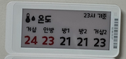
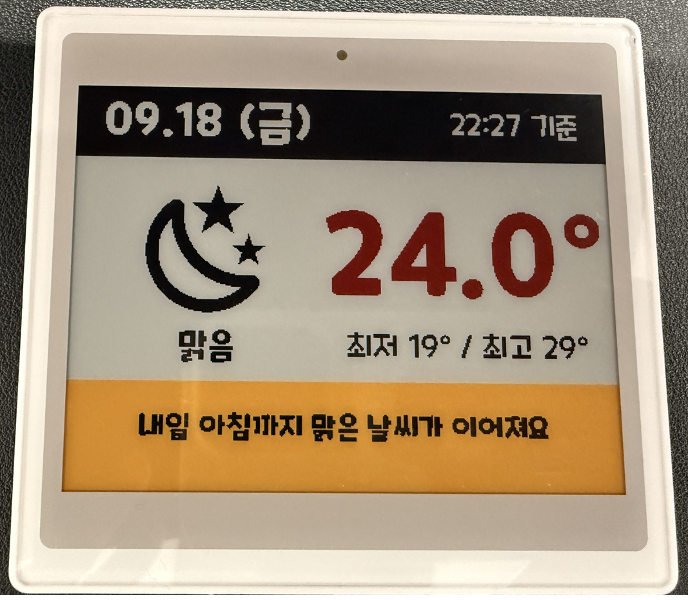

<!-- hass-standards:header:start -->
# BLE ESL for Home Assistant

A Home Assistant custom integration that sends layouts to Bluetooth Low Energy electronic shelf labels.

**English** | [한국어](README.ko.md)

<!-- hass-standards:badges:start -->
[](https://github.com/eigger/hass-ble-esl/releases)
[](#installation)
[](hacs.json)
[](https://github.com/eigger/hass-ble-esl/actions/workflows/tests.yml)
[](https://github.com/eigger/hass-ble-esl/actions/workflows/validate.yml)
[](LICENSE)
[](https://github.com/eigger/hass-ble-esl/releases)
<!-- hass-standards:badges:end -->
<!-- hass-standards:header:end -->


Use one Home Assistant action to send calendars, weather, sensor readings or photos to e-paper tags over Bluetooth. Tags can run for months to years on one battery without a gateway, cloud service or wiring.

It is not part of Home Assistant Core and claims no Core quality tier. [Why e-paper tags? →](docs/usage.md#why-e-paper-tags)

<details>
<summary>Photos of real tags</summary>

**Gicisky · 2.1" (250×128)**


**Gicisky · 2.9" (296×128)**



**Poshiji PSJ-420 · 4.2" (400×300)**



**Gicisky · 10.2" (960×640)**


</details>

[More examples with YAML →](examples/README.md)

## Supported tags

| Protocol | Brand | Sizes | Colors | Status | Buy |
|---|---|---|---|---|---|
| **ETAG** | Hipoink | 2.13" (250 × 122) | BWR | ✅ verified; [protocol notes](docs/etag.md) | [AliExpress](https://de.aliexpress.com/item/1005009110927073.html) |
| **PickSmart** | Gicisky | 2.1" – 10.2" | BW / BWR / BWRY | ✅ verified on hardware | [AliExpress](https://ko.aliexpress.com/item/1005002399342939.html) |
| **XTE** | Poshiji | 1.54" – 7.5" | BWRY | ✅ 2.13", 2.66", 2.9" and 4.2" verified on real tags by owner; other sizes size-only presets | [AliExpress](https://ko.aliexpress.com/item/1005012725381116.html) |
| **WOLINK** | Zhsunyco | 1.54" – 13.3" | BWR / BWRY | ✅ 1.54", 2.66", 3.5", 3.7" and 4.2" BWRY and 2.9" BWR verified on hardware; other sizes untested | [AliExpress](https://ko.aliexpress.com/item/1005009231276243.html) |
| **easyTag** | Zhsunyco | 1.54" – 10.2" | BW / BWR | ⚠️ from specifications, untested | — |

See the [full model list](docs/models.md) for resolutions and model codes, or [add a protocol](custom_components/ble_esl/esl_ble/README.md) for another tag.

## Features

- Write layouts with `ble_esl.write` using [imagespec](https://github.com/eigger/imagespec) elements and Jinja templates. `ble_esl.write_guarded` skips unchanged images, respects Write Lock and debounces bursts.
- **ESL Manager**, a sidebar dashboard and visual designer that exports the same payload as YAML.
- Failure sensors and a diagnostics download that say at which stage a write failed and through which radio.

## Requirements

- **Home Assistant:** 2025.12.0 or later.
- **Bluetooth:** A Bluetooth adapter or an ESPHome Bluetooth proxy that supports active connections. See [Bluetooth](#bluetooth).
- **Device:** A supported tag from [Supported tags](#supported-tags).

## Installation

<!-- hass-standards:installation:start -->
[](https://my.home-assistant.io/redirect/hacs_repository/?owner=eigger&repository=hass-ble-esl)
<!-- hass-standards:installation:end -->

1. Click the badge above to open the repository in Marketplace.
2. If you need to add it yourself, go to **Settings → Marketplace → Add from link** and enter <https://github.com/eigger/hass-ble-esl>. Connect GitHub if prompted.
3. Select **Install**. Restart Home Assistant if prompted, then continue to [Configuration](#configuration).

## Configuration

Tags in range are discovered automatically — confirm them under **Settings → Devices & services**, or add one via **Add integration → BLE ESL**.

Options (Retry Count, Prevent Duplicate Send, Debounce Delay, and Model for WOLINK / easyTag) are under **Configure**; see [docs/usage.md](docs/usage.md#options).

Coming from `hass-gicisky` or `hass-zhsunyco`? Tags must be re-added under the new `ble_esl` domain and `gicisky.write` renamed to `ble_esl.write` — the payload stays the same. **[Migration guide →](docs/migration.md)**

### Bluetooth

For remote Bluetooth, enable active connections with `bluetooth_proxy: active: true`. Start with `esp32_ble_tracker: scan_parameters: active: true` and the default scan interval. Passive scanning also supports GATT when active connections are enabled.

BLE ESL first connects over GATT when you write to the tag. No pairing is needed. Close the ETAG companion app and keep other integrations from writing to the same tag.

See the [Bluetooth proxy guide](https://github.com/eigger/blesession/blob/main/docs/bluetooth.md) for hardware, setup and connection troubleshooting.

## Quick start

From **Developer tools → Actions**:

```yaml
action: ble_esl.write
target:
  device_id: <your device>
data:
  payload:
    - type: text
      value: Hello World!
      x: 10
      "y": 10
      size: 40
```

The tag refreshes in a few seconds.

Add `dry_run: true` to render without sending. The **Preview Content** image entity shows the rendered image rather than reading the panel.

See the [payload guide](docs/payload.md) for rendering options and complete action examples, and the [documentation index](#documentation) for layouts, usage and the visual designer.

<a name="limits-and-warnings"></a>

## Important limitations

> [!WARNING]
> Untested WOLINK and easyTag presets are built from technical specifications and have not been tested on physical tags. If you try one, please report the result in [Discussions](https://github.com/eigger/hass-ble-esl/discussions).

- XTE sizes other than 2.13", 2.66", 2.9" and 4.2" are size-only presets picked by hand; a preset that does not match the hardware can produce a successful write but a wrong-looking panel.
- The designer does not transmit on sensor changes; schedule updates with automations. E-paper is not an LCD — avoid overly frequent redraws; `write_guarded` and the Prevent Duplicate Send / Debounce Delay options help.

## Documentation

| Topic | English | 한국어 |
|---|---|---|
| Usage overview: first layout, visual editor, actions, options, payload & rendering | [docs/usage.md](docs/usage.md) | [docs/ko/usage.md](docs/ko/usage.md) |
| Bluetooth setup and ESPHome example | [docs/bluetooth.md](docs/bluetooth.md) | [docs/ko/bluetooth.md](docs/ko/bluetooth.md) |
| Tag troubleshooting and failure sensors | [docs/troubleshooting.md](docs/troubleshooting.md) | [docs/troubleshooting.ko.md](docs/troubleshooting.ko.md) |
| Actions, response data, entities, fonts | [docs/actions.md](docs/actions.md) | — |
| Supported models and where to buy | [docs/models.md](docs/models.md) | — |
| ESL Manager / Designer | [docs/designer.md](docs/designer.md) | [docs/ko/designer.md](docs/ko/designer.md) |
| Design templates | [docs/design-templates.md](docs/design-templates.md) | [docs/ko/design-templates.md](docs/ko/design-templates.md) |
| Migration from hass-gicisky / hass-zhsunyco | [docs/migration.md](docs/migration.md) | [docs/ko/migration.md](docs/ko/migration.md) |
| Protocol notes (ETAG, XTE) | [docs/etag.md](docs/etag.md), [docs/xte.md](docs/xte.md) | — |
| Examples | [examples/README.md](examples/README.md) | — |
| Development: tests, verified environments, lint, adding a protocol | [docs/development.md](docs/development.md) | — |

## Troubleshooting and diagnostics

- When reporting a bug, attach the tag's diagnostics: **the device page → ⋮ → Download diagnostics**. It contains the protocol, preset, firmware, options, last advertisement and failure counters.
- The tag MAC is redacted, but check the remaining data before posting — see [what to remove](docs/troubleshooting.md#remove-sensitive-information-before-posting).
- If a Poshiji tag required manual model selection, share its size and result through the support links below to help verify the preset.

<!-- hass-standards:support:start -->
## Support

- [Issues](https://github.com/eigger/hass-ble-esl/issues): Report bugs or request features.
- [Discussions](https://github.com/eigger/hass-ble-esl/discussions): Ask questions and share your experience.
<!-- hass-standards:support:end -->

<!-- hass-standards:related-projects:start -->
## Related Projects

- [imagespec](https://github.com/eigger/imagespec): The renderer behind `payload:`.
- [Stash](https://github.com/eigger/stash): Home inventory that prints labels to ESL tags.
- [hass-gicisky](https://github.com/eigger/hass-gicisky): Archived predecessor of BLE ESL.
<!-- hass-standards:related-projects:end -->

<!-- hass-standards:license:start -->
## License

Released under the [MIT License](LICENSE).
<!-- hass-standards:license:end -->
